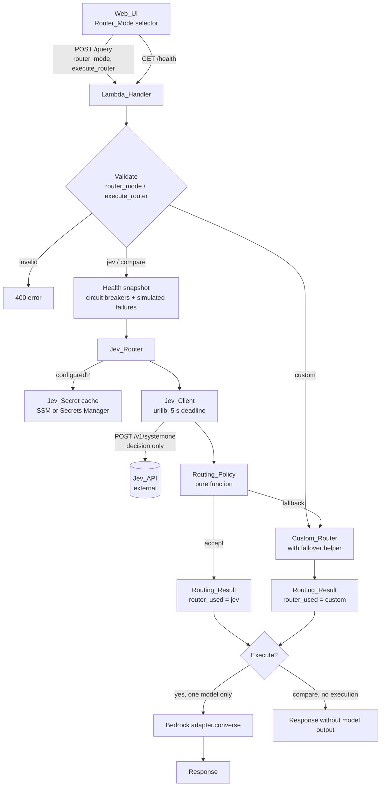
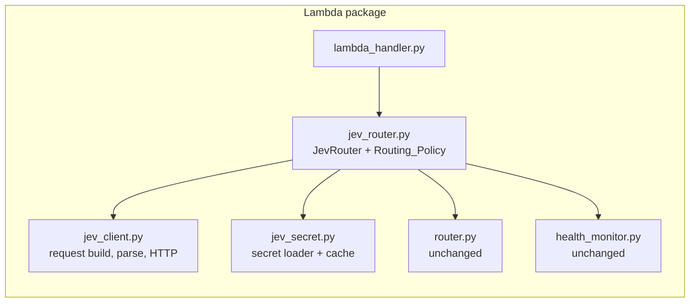
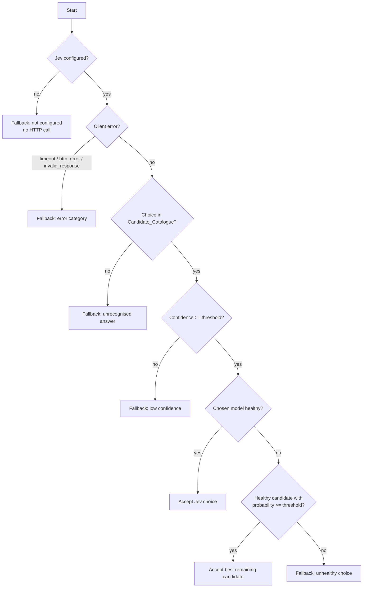

# Design Document

## Overview

This design adds the Jev model router to the `01_intell_model_select` demo as an alternative to the existing `IntelligentModelRouter`. The user picks one of three Router_Modes: `custom`, `jev`, or `compare`.

Jev is a decision service. It receives a `state` and typed `questions` and returns a typed answer with probabilities and confidence. It never runs a model. The Lambda sends one Choice question whose options are the three candidate model IDs (Claude Haiku 4.5, GPT-OSS 20B, Nova Pro). A deterministic Routing_Policy then validates the answer against the Candidate_Catalogue, the Confidence_Threshold, and the current health state. If the answer is unusable, the Lambda falls back explicitly to the Custom_Router and says so in the response.

Key design decisions:

| Decision | Rationale |
|---|---|
| Routing_Policy is a pure function with no I/O | It is the safety-critical part and the main target of property-based tests. Network, secrets, and health lookups are injected at the edge. |
| Jev_Client uses `urllib.request` only | Requirement 3.1: no new Lambda dependencies. The Lambda package already bundles boto3, which is enough for secret reads. |
| One health snapshot per request | Requirement 6.6: both routers and the policy see the same healthy-model set, so `agree` is meaningful. |
| Fallback always produces a Custom_Router decision | The Jev path can never produce a worse outcome than Custom mode. This gives the invariant in Requirement 4.9. |
| Compare is routing-only by default | No model is invoked unless `execute_router` is given, so comparing costs one Jev call and no extra generation. |
| Existing failover logic is extracted into a helper without changing behaviour | The custom path under simulated provider failure must produce the same result in `custom` and `compare` modes. |
| Response shape for `custom` is untouched | Requirement 2: `routing_info` keeps its fields and no `routing_comparison` appears. |

### Defaults confirmed with the user

- Confidence_Threshold default: `0.6`, configurable through `JEV_CONFIDENCE_THRESHOLD`.
- Request field for the mode: `router_mode` (`custom` | `jev` | `compare`; omitted means `custom`).
- Request field for the executed router: `execute_router` (`custom` | `jev`; omitted means no execution in compare mode).
- Jev timeout default: 5 seconds, configurable through `JEV_TIMEOUT_SECONDS`.

### Research summary

I checked the public Jev documentation to confirm the wire format. Content was rephrased for compliance with licensing restrictions.

- The endpoint is `POST https://api.typesafe.ai/v1/systemone` with a Bearer key. A request has a `state` and a `questions` dictionary, and the response has one answer per question key ([Jev getting started](https://promptgenius.net/tools/jev/getting-started)).
- A Choice question has `type: "choice"`, `instructions`, and a `criteria` object that maps each allowed option to a short description. The answer has `choice`, a `probabilities` object over the options, and `confidence`. The response also reports `usage` and the versioned `model` ID ([DigitalOcean System One guide](https://docs.digitalocean.com/products/inference/how-to/use-system-one-api/)).
- The yes/no primitive is called `noul`. It returns a single probability in `noul` with no separate confidence field. Requirement 3.5 calls this the "Boolean question", so the design maps Boolean to `type: "noul"`.
- A Choice supports up to 255 options and the request limit is about 64K tokens, which is far above this demo's needs.
- Error codes to expect are 401 (bad key), 422 (invalid body), 429 (rate limit), and 529 (overload). All map to `http_error` in this design.
- The docs advise pinning a versioned model ID instead of an alias and logging it, because aliases can move. The design pins `jev-1.13.0` by default and makes it configurable through `JEV_MODEL`.
- The docs state that answers are advisory and a schema-valid answer can still be wrong, which supports validating every answer locally.
- The docs show the request `model` field in the DigitalOcean variant. The direct TypeSafe endpoint's handling of `model` is confirmed during live verification (see Live Verification Plan).

## Architecture

### Request flow



### Components and boundaries



New modules are added next to the existing ones in `lambda/`. `router.py`, `health_monitor.py`, `failure_simulator.py`, and `bedrock_adapter.py` are not modified. `lambda_handler.py`, `template.yaml`, the three files in `web/`, and the README are modified.

### Fallback and failure ladder

The Routing_Policy evaluates its rules in a fixed order. The first rule that applies decides the outcome.



If every candidate is unhealthy, the Custom_Router raises its usual `RuntimeError("No healthy models available for routing")`. The Jev path propagates that error unchanged, which satisfies Requirement 4.10 and produces the same 500 `PROCESSING_ERROR` response as Custom mode.

## Components and Interfaces

### 1. `lambda/jev_client.py`: Jev_Client

Pure request building and response parsing, plus one function that performs the HTTP call.

```python
JEV_URL = "https://api.typesafe.ai/v1/systemone"
CHOICE_KEY = "model_choice"
HIGH_CONSEQUENCE_KEY = "high_consequence"

@dataclass(frozen=True)
class JevAnswer:
    choice: str                       # selected option, raw from Jev
    probabilities: Dict[str, float]   # option -> probability, each in [0, 1]
    confidence: float                 # in [0, 1]
    high_consequence: Optional[float] # noul probability, None if not asked
    model_version: Optional[str]      # versioned model ID reported by Jev

@dataclass(frozen=True)
class JevError:
    category: str                     # "timeout" | "http_error" | "invalid_response"
    status_code: Optional[int] = None

JevOutcome = Union[JevAnswer, JevError]

def build_request(query_text: str, characteristics: Dict[str, Any],
                  catalogue: Mapping[str, str], model: str,
                  include_high_consequence: bool) -> Dict[str, Any]: ...

def parse_response(body: bytes, catalogue_ids: Collection[str]) -> JevOutcome: ...

def call_jev(payload: Dict[str, Any], api_key: str, timeout_s: float,
             transport: Callable = _urllib_transport) -> JevOutcome: ...
```

Behaviour:

- `build_request` returns a plain JSON-serialisable dict:
  - `model`: pinned model ID (default `jev-1.13.0`).
  - `state`: `{"query": <text>, "characteristics": {length, complexity_score, estimated_tokens, requires_reasoning, requires_creativity, requires_code, requires_analysis}}`. These values come from the existing `QueryAnalyzer`, so Jev sees the same derived signals the Custom_Router uses.
  - `questions.model_choice`: `{"type": "choice", "instructions": "...", "criteria": {<model_id>: <short capability description>}}`. Option keys are the full model IDs. Each description is generated from the model's `ModelCapabilities` (strengths, relative cost, typical latency), so the catalogue has a single source of truth.
  - `questions.high_consequence`: a `{"type": "noul", "instructions": "..."}` question, included only when `JEV_HIGH_CONSEQUENCE_SIGNAL=true`.
- `call_jev` sets `Authorization: Bearer <key>` and `Content-Type: application/json`, sends POST, and never logs headers.
- The wall-clock deadline is enforced by running the blocking `urlopen` in a single worker thread and waiting with `future.result(timeout=timeout_s)`. A per-socket `urlopen(timeout=...)` alone does not bound total time (a slow trickle of bytes can exceed it). When the deadline expires, `call_jev` returns `JevError("timeout")` immediately and the abandoned thread finishes on its own. This keeps the fallback inside the 500 ms budget of Requirement 10.1.
- Error mapping: `socket.timeout`, deadline expiry, and `URLError` caused by timeout map to `timeout`. Non-2xx statuses (including 401, 422, 429, 529) map to `http_error` with the status code. Network errors that are not timeouts map to `http_error` with `status_code=None`. Bad JSON, missing `answers.model_choice`, non-numeric or out-of-range probabilities, `NaN`, or a `choice` that is not a string map to `invalid_response`.
- `parse_response` does not check the Candidate_Catalogue. Catalogue membership belongs to the Routing_Policy so that the "unrecognised answer" outcome is a policy decision with its own reasoning. The `catalogue_ids` argument is only used to ignore extra probability keys.
- `transport` is injectable, so tests use a fake transport and never touch the network.

### 2. `lambda/jev_secret.py`: Jev_Secret loader

```python
def get_jev_key() -> Optional[str]: ...
def jev_status() -> Dict[str, Any]: ...   # {"configured": bool, "mode": "live" | "recorded"}
```

- Configuration comes from two environment variables set by SAM: `JEV_SECRET_NAME` (empty means not configured) and `JEV_SECRET_TYPE` (`ssm` or `secretsmanager`).
- `ssm` reads with `ssm.get_parameter(Name=..., WithDecryption=True)`. `secretsmanager` reads `get_secret_value`. A Secrets Manager value may be a raw string or JSON with an `api_key` field; both are accepted.
- The key is cached in a module-level variable for the life of the execution environment (Requirement 9.8). Failed reads are not cached as success. A failed read is remembered for 60 seconds so a broken secret does not add an AWS call to every request. During that window Jev is treated as not configured (Requirement 9.7).
- Failures log only the error category (for example `ClientError:AccessDeniedException`) and never the secret value or the full exception message.
- `jev_status()` reports `configured` without calling the Jev_API and never returns the key.

### 3. `lambda/jev_router.py`: Jev_Router and Routing_Policy

```python
@dataclass
class RoutingResult:
    router: str                        # "custom" | "jev"
    model_id: str
    provider: str
    confidence: float                  # [0.0, 1.0]
    latency_ms: int
    reasoning: List[str]
    fallback: bool
    fallback_reason: Optional[str]     # "not_configured" | "timeout" | ... | None
    router_used: str                   # "custom" | "jev"
    probabilities: Dict[str, float]    # empty when Jev gave none
    jev_confidence: Optional[float]    # what Jev reported, even when rejected
    high_consequence: Optional[float]
    mode: str                          # "live" | "recorded"

@dataclass(frozen=True)
class PolicyDecision:
    model_id: Optional[str]            # None means "use the Fallback"
    fallback: bool
    fallback_reason: Optional[str]
    reasoning: List[str]

def apply_policy(outcome: Optional[JevOutcome], *, configured: bool,
                 catalogue_ids: Collection[str], healthy: AbstractSet[str],
                 threshold: float) -> PolicyDecision: ...
```

`apply_policy` is pure: no I/O, no clock, no logging. It implements the ladder in the Architecture section.

Rules in order:

1. `configured` is false: fallback with reason `not_configured` (no call was made, `outcome` is `None`).
2. `outcome` is a `JevError`: fallback with reason equal to the error category.
3. `outcome.choice` not in `catalogue_ids`: fallback with reason `unrecognised`.
4. `outcome.confidence < threshold`: fallback with reason `low_confidence`. The reasoning includes both the received confidence and the threshold.
5. `outcome.choice` in `healthy`: accept it.
6. Otherwise the chosen model is unhealthy. Candidates are the models in `healthy ∩ catalogue_ids`. Pick the one with the highest Jev probability whose probability is at least `threshold`; ties break by catalogue order for determinism. If one exists, accept it and state "substituted unhealthy choice X with Y". If none exists, fallback with reason `unhealthy_choice`.

Rule 6 interpretation: Requirement 4.4 says the remaining candidate must "meet the Confidence_Threshold". Jev reports `confidence` only for the answer as a whole, so the design applies the threshold to each candidate's probability. This is conservative: a substitute is used only if Jev itself puts at least 60% on it.

`JevRouter.route(query_text, snapshot, custom_provider)`:

1. Start a monotonic timer.
2. Check configuration. If configured, build the request, call `call_jev`, and capture the outcome. If not configured, skip the call (no HTTP).
3. Call `apply_policy`.
4. If the policy says fallback, call `custom_provider()` to get the Custom_Router decision (in compare mode this is the already computed decision, so the Custom_Router runs once per request).
5. Stop the timer and build the `RoutingResult`. Latency covers the Jev call up to the policy decision (Requirement 5.3). When a fallback needs a fresh Custom_Router decision in `jev` mode, that routing time is included in the Jev result's latency because the user waits for it.
6. Log one summary line: mode, chosen model, confidence, latency, fallback flag, query length. The query text is never logged (Requirement 11.2). Errors log the category and status code only (Requirement 11.3).

Result fields on fallback: `model_id`, `provider`, and `confidence` come from the Custom_Router decision, `router_used` is `custom`, `fallback` is true, and `jev_confidence` and `probabilities` keep whatever Jev returned so the UI can show why it was rejected.

### 4. `lambda/lambda_handler.py` changes

- `validate_request_parameters` adds `router_mode` (default `custom`) and `execute_router` (default `None`). An invalid value raises `ValueError` with a message that names the bad value and lists accepted values. The existing `lambda_handler` already maps `ValueError` to a 400 `VALIDATION_ERROR`, so no new error path is needed. `execute_router` is only meaningful for `compare`; in other modes it is ignored.
- The existing failover block in `handle_query_request` is moved unchanged into a helper `route_with_failover(router, params, strategy, preferred_provider)`. The `custom` path calls the helper and behaves identically. The compare and fallback paths reuse it so the Custom_Router result already accounts for simulated provider failures.
- `handle_query_request` is split into three steps: (a) resolve routing results for the mode, (b) optionally execute one model, (c) assemble the response. The execution and response-assembly code for the chosen decision is the existing code, reused as is.
- `handle_health_check` adds a `jev` object: `{"configured": bool, "mode": "live"|"recorded", "confidence_threshold": float}`. It does not call the Jev_API and does not include the key.

#### Health snapshot

```python
@dataclass(frozen=True)
class HealthSnapshot:
    healthy_models: FrozenSet[str]   # catalogue-filtered
```

Built once per jev/compare request:

- Start from `router.get_healthy_models()`. This already excludes models whose circuit breaker is open or whose health status is below DEGRADED.
- Remove every model whose provider is marked failed in `_simulated_failures`.
- Intersect with the Candidate_Catalogue.

The same snapshot goes to the Jev_Router. The Custom_Router continues to use its own internal health check, which reads the same health monitor moments earlier, so both routers see the same state within the request.

#### Candidate_Catalogue

The catalogue is the three models named in the requirements, read from `router.model_capabilities`: `ModelType.CLAUDE_HAIKU_4_5`, `ModelType.GPT_OSS_20B`, and `ModelType.NOVA_PRO`. The router also defines Nova Lite and Nova Micro, so the Custom_Router can pick a model outside the catalogue. In that case `agree` is false, which is a genuine difference between the routers and is shown as such. The catalogue is a constant tuple in `jev_router.py`; no other module changes.

#### Mode behaviour

| Mode | Routing | Execution | Response |
|---|---|---|---|
| `custom` or omitted | Custom_Router via `route_with_failover` | Chosen model | Existing shape, no `routing_comparison`, no `router_used` |
| `jev` | Jev_Router (fallback to Custom) | Chosen model | Existing shape; `routing_info` gains `router_used` |
| `compare`, no `execute_router` | Both routers on one snapshot | None | `routing_comparison` only; no `response`, `metadata`, or generation metrics |
| `compare`, `execute_router=custom` or `jev` | Both routers | The named router's model only | Existing fields for the executed router plus `routing_comparison` |

For `jev`, `routing_info.strategy_used` is `"jev"` when Jev's choice was accepted and the request's strategy name when the fallback was used. `routing_time_ms`, `confidence_score`, `considered_models`, and `decision_reasoning` keep their existing names and types. The executed decision is wrapped in a `RoutingDecision` so `record_routing_performance` and the load balancer record the request as they do today. When Jev's choice is accepted, the wrapper uses the model's capability profile for `estimated_response_time_ms` and `estimated_cost_score`.

`record_routing_performance` is only called for the model that actually ran, so a compare request without execution leaves no performance records.

### 5. `template.yaml` changes

```yaml
Parameters:
  JevSecretName:
    Type: String
    Default: ""
    Description: SSM parameter name or Secrets Manager secret name holding the TypeSafe key. Empty means Jev is not configured.
  JevSecretType:
    Type: String
    Default: ssm
    AllowedValues: [ssm, secretsmanager]

Conditions:
  HasJevSecret: !Not [!Equals [!Ref JevSecretName, ""]]
  JevUsesSsm: !And [!Condition HasJevSecret, !Equals [!Ref JevSecretType, ssm]]
  JevUsesSecretsManager: !And [!Condition HasJevSecret, !Equals [!Ref JevSecretType, secretsmanager]]
```

- `Environment.Variables` gains `JEV_SECRET_NAME`, `JEV_SECRET_TYPE`, `JEV_CONFIDENCE_THRESHOLD` (`"0.6"`), `JEV_TIMEOUT_SECONDS` (`"5"`), `JEV_MODEL` (`jev-1.13.0`), and `JEV_HIGH_CONSEQUENCE_SIGNAL` (`"false"`). None of these hold a secret value.
- The function's `Policies` statement list adds one statement per backend, each wrapped in `Fn::If` on its condition with `Ref: AWS::NoValue` otherwise, so an empty parameter adds no permission (Requirement 9.4):
  - SSM: `ssm:GetParameter` on `arn:aws:ssm:${Region}:${AccountId}:parameter/${name without leading slash}` only.
  - Secrets Manager: `secretsmanager:GetSecretValue` on `arn:aws:secretsmanager:${Region}:${AccountId}:secret:${name}-??????` only (the suffix is the random part Secrets Manager appends).
- The secret itself is not created by the stack. It is created out-of-band so the key is never in the template, parameters file, `samconfig.toml`, or CloudFormation outputs. `samconfig.toml` keeps `parameter_overrides = []`. The name is supplied at deploy time through the existing `deploy-sam.sh` using an environment variable (`JEV_SECRET_NAME`), which only contains a name.
- The Lambda timeout stays at 900 seconds, which is far above Jev timeout + routing + generation (Requirement 10.4). The practical ceiling is API Gateway's 29-second integration timeout. A 5-second Jev call plus a normal generation fits, and a Jev failure falls back within about 5.5 seconds in the worst case.

### 6. Web_UI changes (`web/index.html`, `web/app.js`, `web/styles.css`)

- **Mode selector:** a radio group (Custom, Jev, Compare), default Custom. Radio inputs have real labels and are keyboard operable.
- **Configuration state:** on load the UI calls `GET /health` and reads `jev.configured`. If false, the Jev and Compare radios are `disabled` and labelled "not configured". If the health call fails, the selector stays on Custom with Jev and Compare disabled (Requirement 8.7).
- **Execute choice (Compare only):** a second radio group "Execute with: None | Custom | Jev", default None.
- **Request:** `app.js` adds `router_mode` and, in Compare mode with a selection, `execute_router` to the POST body.
- **Comparison panel:** when the response has `routing_comparison`, two panels render side by side (stacked on narrow screens). Each shows the chosen model, confidence, routing latency, and reasoning steps. A banner shows "Routers agree" or "Routers disagree". Agreement and disagreement use an icon plus a text label as well as colour (Requirement 7.4). The Jev panel shows "Fallback to Custom" and the fallback reason when `fallback` is true.
- **No execution:** the answer area is hidden. An "Run with Custom" and "Run with Jev" action resends the stored query with `router_mode=compare` and the chosen `execute_router`, without asking for the text again. Both routers are re-evaluated on that request, which keeps the server stateless. The UI notes this and the new call may show a different Jev result.
- **Privacy notice:** a visible notice states that query text is sent to TypeSafe whenever Jev or Compare is selected. In recorded mode the notice says the query is not sent and every Jev result is labelled "recorded sample, not live".
- **Safe rendering:** all model output and reasoning strings are inserted with `textContent`, not `innerHTML`, since reasoning and fallback text derive from external responses.
- **Architecture view:** new nodes for Jev_Router, Jev_API (labelled "external service, returns a decision only, does not run the model"), Routing_Policy, the Fallback arrow to the Custom_Router, and the Jev_Secret ("stored server-side"). When `jev.configured` is false, the Jev nodes carry a "not configured" tag. The code viewer gains three snippets: the Jev_Client request, the Jev_Choice_Question construction, and the Routing_Policy.

### 7. Recorded Jev mode (optional, Requirement 15)

`JEV_MODE=recorded` makes `call_jev` unnecessary: `jev_client.load_recording(query)` reads `lambda/jev_recordings.json`, a list of `{query_normalised, response}` entries whose `response` is the exact parsed-response shape. Matching is by normalised exact text (trimmed, case-folded, whitespace-collapsed). A miss returns `JevError("invalid_response")` tagged `no_recording`, which the policy turns into the fallback with the reasoning "no recording matched". In recorded mode the secret is not needed, `/health` reports `{"configured": true, "mode": "recorded"}`, and `RoutingResult.mode` is `recorded` so the UI can label it.

### 8. Documentation

The README gains a Jev section covering: the three modes and how the routers differ; creating the secret (`aws ssm put-parameter --type SecureString` or `aws secretsmanager create-secret`, with the value read from a prompt or file, never typed into shell history or committed); passing only the secret *name* to `sam deploy --parameter-overrides`; that the demo works without a key; the privacy note; `JEV_CONFIDENCE_THRESHOLD` (default `0.6`) and `JEV_TIMEOUT_SECONDS` (default `5`); the request fields `router_mode` and `execute_router`; the `routing_comparison` schema; and cleanup (delete the parameter or secret after the stack is deleted, since the stack does not own it). `CLEANUP-GUIDE.md` gets the same cleanup step.

## Data Models

### Request (additions)

```json
{
  "query": "string (existing)",
  "router_mode": "custom | jev | compare",
  "execute_router": "custom | jev"
}
```

### `routing_info` for `jev` mode

Existing fields (`strategy_used`, `routing_time_ms`, `confidence_score`, `considered_models`, `decision_reasoning`) plus:

```json
{ "router_used": "jev | custom" }
```

### `routing_comparison` (compare responses only)

```json
{
  "agree": true,
  "custom": {
    "router": "custom",
    "model_id": "us.anthropic.claude-haiku-4-5-20251001-v1:0",
    "provider": "anthropic",
    "confidence": 0.12,
    "latency_ms": 4,
    "reasoning": ["..."],
    "fallback": false,
    "fallback_reason": null
  },
  "jev": {
    "router": "jev",
    "router_used": "jev",
    "model_id": "openai.gpt-oss-20b-1:0",
    "provider": "openai",
    "confidence": 0.91,
    "jev_confidence": 0.91,
    "latency_ms": 143,
    "reasoning": ["..."],
    "fallback": false,
    "fallback_reason": null,
    "probabilities": {
      "us.anthropic.claude-haiku-4-5-20251001-v1:0": 0.06,
      "openai.gpt-oss-20b-1:0": 0.91,
      "amazon.nova-pro-v1:0": 0.03
    },
    "high_consequence": null,
    "mode": "live"
  }
}
```

`agree` is `custom.model_id == jev.model_id`, computed once in the handler from the two results. When the Jev result is a fallback, its `model_id` equals the Custom result's, so `agree` is true and the UI shows "Fallback to Custom" rather than implying Jev independently agreed.

### Health response (addition)

```json
{ "jev": { "configured": false, "mode": "live", "confidence_threshold": 0.6 } }
```

### Jev wire format

Request:

```json
{
  "model": "jev-1.13.0",
  "state": {
    "query": "…",
    "characteristics": { "length": 120, "complexity_score": 0.4, "estimated_tokens": 30,
                          "requires_reasoning": true, "requires_creativity": false,
                          "requires_code": false, "requires_analysis": true }
  },
  "questions": {
    "model_choice": {
      "type": "choice",
      "instructions": "Which model is the best fit for answering this query? …",
      "criteria": { "<model_id>": "<capability summary>", "…": "…" }
    }
  }
}
```

Response:

```json
{
  "model": "jev-1.13.0",
  "answers": {
    "model_choice": {
      "type": "choice",
      "choice": "openai.gpt-oss-20b-1:0",
      "probabilities": { "…": 0.91 },
      "confidence": 0.91
    }
  },
  "usage": { "input_tokens": 349, "output_tokens": 39 }
}

## Correctness Properties

*A property is a characteristic or behavior that should hold true across all valid executions of a system-essentially, a formal statement about what the system should do. Properties serve as the bridge between human-readable specifications and machine-verifiable correctness guarantees.*

The properties below cover the pure and mockable logic: request building, response parsing, the Routing_Policy, result assembly, and request validation. UI behaviour, template contents, and README content are covered by example-based and smoke tests (see Testing Strategy).

After reflection, several acceptance criteria were merged: 1.3, 2.1, 2.2, and 8.6 into Property 1; 1.6 and 6.7 into Property 2; 3.3, 3.4, and 3.5 into Property 3; 4.7 and 4.8 into Property 12; 5.1, 5.2, 5.4, and 2.4 into Property 13; 6.1, 6.2, and 6.3 into Property 14; 6.4 and 6.5 into Property 15; and 8.3, 9.5, and 11.2 into Property 17.

### Property 1: Custom responses keep the legacy shape

For any query, strategy, and provider preference, a request with `router_mode` equal to `custom` or omitted returns a `routing_info` object whose field names and value types equal the pre-feature set (`strategy_used`, `routing_time_ms`, `confidence_score`, `considered_models`, `decision_reasoning`) and contains no `routing_comparison` field. This also holds when the Jev_Secret is not configured.

**Validates: Requirements 1.3, 2.1, 2.2, 8.6**

### Property 2: Invalid mode values are rejected with a helpful 400

For any string that is not one of the accepted values, supplying it as `router_mode` (accepted: `custom`, `jev`, `compare`) or as `execute_router` (accepted: `custom`, `jev`) makes validation fail, and the error message contains the offending value and lists every accepted value.

**Validates: Requirements 1.6, 6.7**

### Property 3: Request construction reflects the query, characteristics, and catalogue

For any query text, derived characteristics, and catalogue, `build_request` produces a payload whose `state` contains the query text and every characteristic value, whose `model_choice` question has exactly the catalogue model IDs as option keys with a non-empty description for each, and which contains a `high_consequence` boolean question if and only if the high-consequence signal is enabled.

**Validates: Requirements 3.3, 3.4, 3.5**

### Property 4: Request payload JSON round trip

For any valid request payload produced by `build_request`, serialising it to JSON and parsing it back yields an equivalent payload.

**Validates: Requirements 3.9**

### Property 5: Valid responses parse to the matching answer

For any well-formed Jev response body with a choice, finite probabilities in [0, 1], and a confidence in [0, 1], `parse_response` returns a `JevAnswer` whose choice, probabilities, and confidence equal the values in the body.

**Validates: Requirements 3.6**

### Property 6: Failures map to a categorised error and never raise

For any HTTP status outside 2xx, any malformed or structurally invalid body (including non-JSON, missing keys, wrong types, `NaN`, and out-of-range numbers), and any transport exception or timeout, `call_jev` returns a `JevError` whose category is one of `timeout`, `http_error`, or `invalid_response`, and no exception propagates.

**Validates: Requirements 3.8**

### Property 7: The final route is always a healthy catalogue member or the declared Fallback

For any Jev outcome (any choice string, any confidence, any probabilities, any error category, or not configured) and any healthy-model set, the Jev_Router returns a model that is either a member of the healthy Candidate_Catalogue models accepted from Jev, or the Custom_Router fallback model with the fallback indicator set to true. The returned model is never an unhealthy model and never a model Jev invented.

**Validates: Requirements 4.1, 4.9, 8.5**

### Property 8: Unrecognised answers fall back

For any choice string that is not in the Candidate_Catalogue, the Routing_Policy falls back and the reasoning states that the answer was unrecognised.

**Validates: Requirements 4.2**

### Property 9: Low confidence falls back

For any answer with a catalogue choice and a confidence below the Confidence_Threshold, and any threshold in (0, 1], the Routing_Policy falls back and the reasoning contains both the received confidence and the threshold.

**Validates: Requirements 4.3**

### Property 10: Unhealthy choices are never selected and are substituted only by qualifying candidates

For any answer whose choice is a catalogue model that is not in the healthy set, any probabilities, and any threshold, the Routing_Policy does not select the unhealthy model. It selects the healthy candidate with the highest probability that is at least the threshold if one exists, and otherwise falls back. The reasoning names the action taken.

**Validates: Requirements 4.4**

### Property 11: Client errors fall back and name the category

For any `JevError` category (`timeout`, `http_error`, `invalid_response`), the Routing_Policy falls back and the reasoning contains the category.

**Validates: Requirements 4.5**

### Property 12: Fallback indicator and `router_used` agree

For any Jev_Router result, `fallback` is true if and only if `router_used` is `custom`, and `fallback` is false if and only if `router_used` is `jev`.

**Validates: Requirements 4.7, 4.8**

### Property 13: Routing results are complete and valid

For any Jev outcome, the Routing_Result contains a model ID, provider, a confidence in [0.0, 1.0], a non-negative integer latency, and a non-empty reasoning list that states whether the decision came from a Jev choice or from the Fallback. When the outcome is a valid answer the result's probabilities equal Jev's probabilities. In `jev` mode, `routing_info` has the legacy field names plus `router_used`.

**Validates: Requirements 5.1, 5.2, 5.4, 2.4**

### Property 14: Compare executes at most one model, and only the named one

For any query and any `execute_router` value in {none, `custom`, `jev`} with `router_mode` equal to `compare`, the number of model invocations is 0 when none is named and exactly 1 otherwise, the invoked model equals the chosen model of the named router, and the response always contains `routing_comparison`.

**Validates: Requirements 6.1, 6.2, 6.3**

### Property 15: `agree` equals model ID equality

For any pair of Routing_Results, the `routing_comparison` contains both results and `agree` is true if and only if the two chosen model IDs are equal.

**Validates: Requirements 6.4, 6.5**

### Property 16: Jev failures never break a request the Custom_Router can complete

For any Jev outcome, a `jev` mode request whose Custom_Router can complete returns HTTP 200.

**Validates: Requirements 10.2**

### Property 17: Secrets and query text never leak

For any API key string, any query text, and any Jev outcome (including errors whose exception messages contain the key), the key does not appear in captured logs, the response body, error messages, or the health response; and the full query text does not appear in Jev-related log entries.

**Validates: Requirements 8.3, 9.5, 11.2**

### Property 18: An unmatched recording falls back

For any query that matches no entry in the recorded Jev file, recorded mode falls back to the Custom_Router and the reasoning states that no recording matched.

**Validates: Requirements 15.5**

## Error Handling

| Condition | Detection | Behaviour | HTTP |
|---|---|---|---|
| `router_mode` or `execute_router` invalid | `validate_request_parameters` | `ValueError` naming the value and listing accepted values; existing handler maps to `VALIDATION_ERROR` | 400 |
| Jev not configured (no secret name, read failed, or read in backoff window) | `jev_status()` | No HTTP call; policy falls back with reason `not_configured`; reasoning says "Jev not configured" | 200 |
| Secret read fails | `ClientError` or other exception in `jev_secret` | Log category only; treat as not configured for 60 s; continue with fallback | 200 |
| Jev request times out | Worker-thread deadline | `JevError("timeout")`; fallback within the deadline plus overhead | 200 |
| Jev returns 401, 422, 429, 529, or any non-2xx | Status check | `JevError("http_error", status)`; fallback; status logged, headers and body not logged | 200 |
| Jev returns malformed body, wrong types, out-of-range numbers, missing answer | `parse_response` | `JevError("invalid_response")`; fallback | 200 |
| Choice not in catalogue | `apply_policy` | Fallback with reason `unrecognised` | 200 |
| Confidence below threshold | `apply_policy` | Fallback with confidence and threshold in reasoning | 200 |
| Chosen model unhealthy | `apply_policy` | Substitute a qualifying healthy candidate or fall back | 200 |
| All candidates unhealthy | Custom_Router raises | Propagated unchanged; same message as Custom mode | 500 `PROCESSING_ERROR` |
| `JEV_CONFIDENCE_THRESHOLD` or `JEV_TIMEOUT_SECONDS` unparsable or out of range | Config read at import | Use defaults 0.6 and 5, log a warning | n/a |
| Unexpected exception inside the Jev path | Catch-all in `JevRouter.route` | Log the exception class only, treat as `invalid_response`, fall back | 200 |
| Bedrock execution fails | Existing handler code | Unchanged | 500 |

Rules that apply everywhere:

- The key is only passed to the `Authorization` header builder. It is never placed in a log message, exception message, response field, or `repr` of a dataclass (the key is not stored on any result object).
- Exceptions that may embed request details (for example `urllib` errors) are reduced to their class name before logging.
- Jev's `reasoning` text is never trusted as markup. The UI renders it with `textContent`.

## Testing Strategy

### Approach

Both unit tests and property-based tests are used. Property tests carry the policy, parsing, validation, and assembly logic, which have large input spaces. Example tests cover wiring, configuration, templates, and UI. All automated tests run offline with a fake Jev transport and no real key (Requirement 14.1).

- **Language and tools:** Python 3.12, `pytest`, and `hypothesis` (already used elsewhere in this repository; pin the version in a `tests/requirements.txt` for the demo).
- **Location:** `01_intell_model_select/tests/`. Test-only dependencies are not added to `lambda/requirements.txt`.
- **Property tests:** each correctness property is implemented by a single Hypothesis test with `@settings(max_examples=100)` or more. Each test has a comment in the form `# Feature: jev-router-comparison, Property N: <property text>`.
- **Not implemented from scratch:** generation and shrinking use Hypothesis.

### Generators

- `jev_outcomes()`: one of a valid `JevAnswer` (arbitrary choice from the catalogue or arbitrary text, probabilities over catalogue IDs in [0, 1], confidence in [0, 1]), a `JevError` with each category, or "not configured".
- `health_states()`: any subset of the catalogue as the healthy set, including empty (handled as the all-unhealthy edge case).
- `bad_bodies()`: non-JSON bytes, JSON of the wrong type, missing `answers`, wrong `choice` type, `NaN`, negative or greater-than-one numbers.
- `queries()`: arbitrary Unicode text up to the 10,000 character limit, including whitespace-only and very short strings after validation.
- `api_keys()`: arbitrary printable strings of length 8-64, used as the key and embedded into fake exception messages.

### Mapping from the requirements' test list (Requirement 14)

| Requirement | Test |
|---|---|
| 14.2 timeout | Example plus Property 11 |
| 14.3 unknown model ID | Example plus Property 8 |
| 14.4 low confidence | Example plus Property 9 |
| 14.5 open circuit breaker | Example using the real `ModelHealthMonitor` with a forced-open breaker, plus Property 10 |
| 14.6 simulated provider failure | Example setting `_simulated_failures` and checking the snapshot excludes that provider's models |
| 14.7 no secret, no HTTP | Example with a transport that fails the test if called |
| 14.8 arbitrary outcomes | Property 7 |
| 14.9 `agree` | Property 15 |
| 14.10 payload round trip | Property 4 |
| 14.11 custom shape | Property 1 |
| 14.12 compare without execution | Property 14 |
| 14.13 secret never appears | Property 17 |
| 14.14 health `jev.configured` | Example in both states, plus the no-call and no-key assertions |

### Example, edge-case, and smoke tests

- Timeout bound: a fake transport that sleeps past a small configured timeout; assert the result is `JevError("timeout")` and the call returned within the timeout plus 0.5 s (Requirement 10.1).
- All candidates unhealthy: Jev path raises the same `RuntimeError` message as the Custom_Router (Requirement 4.10).
- Secret loader: SSM and Secrets Manager reads via stubbed boto3 clients; second call does not read again; read failure leads to not configured with a category-only log (Requirements 9.7, 9.8).
- Latency independence in compare: injected clock shows two separate latencies (Requirement 10.3).
- Log content: one captured Jev decision log line contains mode, model, confidence, latency, and fallback flag (Requirement 11.1).
- `build_request` example: asserts method, URL, and Bearer header via the fake transport (Requirement 3.2).
- Recorded mode: matching query returns the recorded answer with no transport call; health reports `mode: recorded` (Requirements 15.1, 15.2).
- Template smoke tests: parse `template.yaml` and assert the optional parameter default is empty, IAM statements are conditional and scoped to one resource, no secret-like value appears, and the function timeout exceeds the Jev timeout plus routing time (Requirements 9.2, 9.3, 9.4, 10.4).
- Repository smoke test: scan committed demo files, `samconfig.toml`, and scripts for key-shaped strings (Requirement 9.6). Confirm `lambda/requirements.txt` is unchanged (Requirement 3.1).
- UI tests: DOM-level example tests (jsdom or manual checklist) for the selector default, disabled options when not configured, side-by-side panels, agreement text labels, the fallback label, execute choice default of none, the "run with" action, the privacy notice, and the architecture view labels (Requirements 1.1, 1.2, 7.x, 8.4, 8.7, 12.x). Property-based testing does not apply to UI rendering, so these are snapshot or checklist tests.

### Why not property tests everywhere

Template contents, IAM scoping, README text, and UI layout have no meaningful "for all inputs" statement. The AWS secret-store calls and the Jev HTTP endpoint are external services, so they are covered by stubbed example tests and by the live verification below rather than by 100 iterations of calls.

## Live Verification Plan

The mocked tests prove the policy. They cannot prove that the real Jev API accepts our request shape, so a short, separate live pass is part of the work. It is manual or opt-in, never part of the default test run, and never needs the key to appear in the repo or in chat.

### Handling the key

- The key lives only in SSM Parameter Store (SecureString) or Secrets Manager, for example `/genai-demo/jev-api-key`.
- Create it from a hidden prompt so the value does not enter shell history, the repo, or this conversation:

  ```bash
  read -rs JEV_KEY && aws ssm put-parameter --name /genai-demo/jev-api-key \
    --type SecureString --value "$JEV_KEY" && unset JEV_KEY
  ```

  (A Secrets Manager equivalent uses `aws secretsmanager create-secret` with the same pattern.)
- Only the parameter *name* is passed to `sam deploy --parameter-overrides JevSecretName=/genai-demo/jev-api-key JevSecretType=ssm`.
- If the key is ever pasted into chat, a file in the repo, or a log, rotate it in the TypeSafe console and update the parameter.
- Live tests read the key through the same `jev_secret` loader the Lambda uses, using the developer's AWS credentials.

### Step 1: Contract check (local, opt-in)

Run `RUN_LIVE_JEV=1 pytest tests/live -m live`. These tests are skipped unless that variable is set. They send a small number of requests and assert only the contract, never specific model choices:

- A request with the pinned `JEV_MODEL` returns 2xx. Repeat once without the `model` field to learn whether it is required on the direct endpoint, then keep the working form.
- Option keys containing `.`, `:`, and `-` (the real model IDs) are accepted in `criteria`. If they are rejected, switch to short aliases (for example `haiku_4_5`, `gpt_oss_20b`, `nova_pro`) with an alias-to-ID map inside `jev_client`, and re-run Properties 3 and 5 with the alias layer.
- The response has `answers.model_choice` with `choice`, `probabilities`, and `confidence`, and the probability keys equal the criteria keys.
- The `high_consequence` `noul` question returns a probability in [0, 1] and no `confidence`.
- An obviously invalid in-memory key returns 401, mapped to `http_error` with status 401, and the key does not appear in captured output.
- Measure round-trip latency over about 10 calls and confirm it is well under the 5-second timeout. Record min, median, and max.

### Step 2: Deploy and permissions

- Deploy with `JevSecretName` set. Confirm in `/health` that `jev.configured` is true.
- Confirm the Lambda role has read access to only that one parameter or secret.
- Confirm a SecureString encrypted with the default key decrypts from the Lambda without extra KMS grants. If it does not, add a `kms:Decrypt` statement scoped to the key and the SSM service, and note it in the README.
- Deploy once with the parameter empty and confirm `jev.configured` is false and Custom mode behaves as before.

### Step 3: End-to-end behaviour

With the deployed API, send a small, varied set of queries (a code question, a creative request, a short factual question, a long analytical one) in each mode:

- `custom`: response unchanged from before the feature.
- `jev`: `router_used` is `jev` for confident answers; the executed model equals the chosen model.
- `compare` with no `execute_router`: no generated response, both panels filled, `agree` consistent with the two model IDs.
- `compare` with `execute_router=jev` and `custom`: exactly one generation.
- Simulate a provider failure with the admin endpoint: the failed provider's models are not selected by either router, and a Jev choice for them is substituted or falls back.
- Force a timeout by deploying with `JEV_TIMEOUT_SECONDS=0.05` for one run: the request succeeds through the fallback and the reasoning says "timeout".
- Force a low-confidence fallback with `JEV_CONFIDENCE_THRESHOLD=0.99` for one run.

### Step 4: Logs and secrets hygiene

- Search CloudWatch logs for the Lambda for the key prefix, the `Authorization` header text, and a distinctive query string. None should appear (Properties 17).
- Run a repository scan (for example `git grep` for the key prefix and for `Bearer `) before any commit.

### Step 5: Capture recordings (optional)

Save the sanitised Jev responses from Step 3 as `lambda/jev_recordings.json` for recorded mode. Responses contain no key and no request headers. This gives an offline demo path based on real answers.

### Pass criteria

The live pass is complete when the contract tests pass, all Step 3 behaviours are observed, no secret or query text is found in logs, and any contract findings (the `model` field, option-key format, KMS) are folded back into the design and tests. Findings that change the request shape also update Property 3 and Property 4 tests.

### Cost and limits

Jev bills per input token and output is free, and each routing call here sends a short query and three one-line option descriptions, so the live pass costs very little. Stay below the published rate limits by keeping the pass to a few dozen calls.
